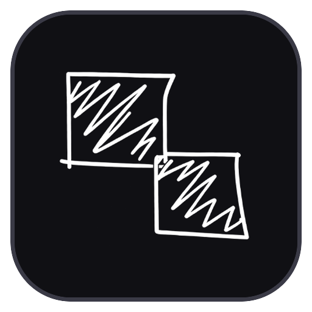

<!-- PROJECT SHIELDS -->
<p align="center">
  <a href="https://github.com/piskevalee-cpu/OpenSync-Launcher/stargazers"></a>
  <a href="https://github.com/piskevalee-cpu/OpenSync-Launcher/network/members"></a>
  <a href="https://github.com/piskevalee-cpu/OpenSync-Launcher/issues"></a>
  <a href="https://github.com/piskevalee-cpu/OpenSync-Launcher/blob/main/LICENSE"></a>
</p>

<!-- PROJECT LOGO -->
<br />
<div align="center" id="readme-top">
  <a href="https://github.com/piskevalee-cpu/OpenSync-Launcher">
    
  </a>

  <p align="center">
    Native desktop game cabinet and runner for self-hosted <a href="https://github.com/piskevalee-cpu/OpenSync">OpenSync</a> archives with Proton support, screen-time tracking, and automatic save sync.
    <br />
    <br />
    <a href="https://github.com/piskevalee-cpu/OpenSync-Launcher/issues/new?labels=bug">Report Bug</a>
    &middot;
    <a href="https://github.com/piskevalee-cpu/OpenSync-Launcher/issues/new?labels=enhancement">Request Feature</a>
  </p>
</div>

<!-- TABLE OF CONTENTS -->
<details>
  <summary>Table of Contents</summary>
  <ol>
    <li>
      <a href="#what-is-opensync-launcher">What is OpenSync Launcher?</a>
      <ul>
        <li><a href="#how-it-works">How it Works</a></li>
        <li><a href="#built-with">Built With</a></li>
      </ul>
    </li>
    <li>
      <a href="#getting-started">Getting Started</a>
      <ul>
        <li><a href="#prerequisites">Prerequisites</a></li>
        <li><a href="#installation">Installation</a></li>
        <li><a href="#configuration">Configuration</a></li>
      </ul>
    </li>
    <li><a href="#usage">Usage</a>
      <ul>
        <li><a href="#workspace-crates">Workspace Crates</a></li>
      </ul>
    </li>
    <li><a href="#roadmap">Roadmap</a></li>
    <li><a href="#contributing">Contributing</a></li>
    <li><a href="#license">License</a></li>
    <li><a href="#acknowledgments">Acknowledgments</a></li>
  </ol>
</details>

<!-- WHAT IS OPENSYNC LAUNCHER -->
## What is OpenSync Launcher?

OpenSync Launcher is the companion desktop client for [OpenSync](https://github.com/piskevalee-cpu/OpenSync). It connects to one or more self-hosted OpenSync LAN instances, streams and extracts your games straight to disk, runs Linux native titles and Windows builds via Proton, tracks session playtime, and keeps your saves automatically synced in the background.

Installed games, saved sessions, playtime history, and offline save-sync queues stay isolated per server profile, so switching between machines or different OpenSync instances on your network works seamlessly without logging out or losing progress.

<p align="right">(<a href="#readme-top">back to top</a>)</p>

## How it Works

Downloads stream directly over the LAN using OpenSync's uncompressed `STORE` mode, extracting files straight from the HTTP response body while verifying SHA-256 hashes inline with zero temporary archive files on disk.

When you launch a game, OpenSync Launcher picks either native execution or your selected Proton compatibility runtime, tracks active screen time with system suspend/sleep exclusion, and triggers differential save sync as soon as the game exits — or queues it offline and flushes automatically when your OpenSync server becomes reachable again.

Key features:

* **Multi-instance profile manager** — remembers servers, session cookies, user avatars, and downloaded games across restarts, with exponential-backoff auto-reconnect
* **Wire-speed streaming downloads** — zero-temp-file ZIP extraction, path-traversal protection, inline SHA-256 verification, pause/resume/cancel, bandwidth cap, and a 60fps Download Manager waveform
* **Automatic background & post-exit save sync** — parallel `rayon` hashing against the clean manifest, concurrent 4 MB chunked overlay uploads, mass-deletion guard, offline pending queue, and periodic background flush
* **Proton auto-detection & installer** — discovers OpenSync-managed, Steam `compatibilitytools.d`, Steam `common`, and Flatpak Steam Proton builds; offers one-click SHA-512 verified GE-Proton downloads with per-game WINE prefix isolation
* **Screen-time & controller support** — cumulative playtime tracking per game, full W3C Gamepad API + keyboard spatial navigation with bottom control hints, and OpenSync Web's dark `2:3` Steam capsule UI
* **Profile & avatar sync** — view account activity, upload or remove your profile picture, customize instance labels, and display synced avatars across the launcher

<p align="right">(<a href="#readme-top">back to top</a>)</p>

### Built With

* [![Rust][Rust-badge]][Rust-url]
* [![Tauri][Tauri-badge]][Tauri-url]
* [![SQLite][SQLite-badge]][SQLite-url]
* [![JavaScript][JS-badge]][JS-url]

<p align="right">(<a href="#readme-top">back to top</a>)</p>

<!-- GETTING STARTED -->
## Getting Started

You only need a running **[OpenSync](https://github.com/piskevalee-cpu/OpenSync)** server on your LAN or `localhost`.

### Installation

Download prebuilt binaries for **`v0.1.0`** from [GitHub Releases](https://github.com/piskevalee-cpu/OpenSync-Launcher/releases/tag/v0.1.0):

#### Linux AppImage (amd64)

[Download `OpenSync_Launcher_0.1.0_amd64.AppImage`](https://github.com/piskevalee-cpu/OpenSync-Launcher/releases/download/v0.1.0/OpenSync_Launcher_0.1.0_amd64.AppImage), make it executable, and run:

```sh
chmod +x OpenSync_Launcher_0.1.0_amd64.AppImage
./OpenSync_Launcher_0.1.0_amd64.AppImage
```

#### Linux Flatpak (amd64)

Fetch from [v0.1.0 Releases](https://github.com/piskevalee-cpu/OpenSync-Launcher/releases/download/v0.1.0/OpenSync_Launcher_0.1.0_amd64.flatpak) and install in one command:

```sh
curl -fSL https://github.com/piskevalee-cpu/OpenSync-Launcher/releases/download/v0.1.0/OpenSync_Launcher_0.1.0_amd64.flatpak -o /tmp/opensync.flatpak && flatpak install --user -y /tmp/opensync.flatpak && flatpak run io.opensync.launcher
```

#### Windows (x64)

[Download `OpenSync_Launcher_0.1.0_x64.exe`](https://github.com/piskevalee-cpu/OpenSync-Launcher/releases/download/v0.1.0/OpenSync_Launcher_0.1.0_x64.exe) and run directly.

### Build from Source

#### Prerequisites

* **Rust** (stable toolchain via `rustup`)
* On Windows: Visual Studio C++ Build Tools (MSVC) + WebView2 runtime
* On Linux: WebKitGTK 4.1 & GTK3 development packages:
  * **openSUSE Tumbleweed**: `sudo zypper in webkitgtk3-devel gtk3-devel libsoup-devel librsvg-devel`
  * **Ubuntu / Debian**: `sudo apt install libwebkit2gtk-4.1-dev libgtk-3-dev libsoup-3.0-dev librsvg2-dev patchelf`

#### Compile & Run

```sh
git clone https://github.com/piskevalee-cpu/OpenSync-Launcher.git
cd OpenSync-Launcher
cargo build --release -p launcher-tauri
```

Run in development mode with `cargo run -p launcher-tauri`, or run the workspace test suite with:

```sh
cargo test --workspace --exclude launcher-tauri
```

### Configuration

| Env var | Default | Description |
| --- | --- | --- |
| `OPENSYNC_LAUNCHER_DATA` | `$XDG_DATA_HOME/opensync-launcher` | App data dir (SQLite DB, `secrets.json`, prefixes, Proton installs, cover/avatar cache) |
| `OPENSYNC_LAUNCHER_GAMES_DIR` | `~/Games/OpenSync` | Override destination root for newly downloaded games (also editable in Settings) |

<p align="right">(<a href="#readme-top">back to top</a>)</p>

<!-- USAGE -->
## Usage

* **Connect to an OpenSync server**: enter your server URL (e.g. `http://192.168.1.42:3000` or `127.0.0.1:3000` — pasted `#/` routes and `0.0.0.0` hosts normalize automatically), instance label, and account credentials (sign in or create an account).
* **Browse & install**: hover or focus any `2:3` capsule cover to reveal the circular glass Play / Download control and rolling stats; click the card to configure launch executables, Proton runtime overrides, or run manual save syncs.
* **Downloads & Proton**: monitor live throughput graphs, pause/resume or limit download speed in `downloads`, and check/install GE-Proton builds or set your default `Games directory` in `settings`.
* **Controller navigation**: connect any gamepad (or use Arrow keys / `Enter` / `Escape` / `I` / `[` `]`) to browse cards, inspect game details, switch tabs, and control downloads from a couch or handheld.

### Workspace Crates

| Crate | Purpose |
| --- | --- |
| `crates/launcher-db` | Bundled SQLite store (profiles, remembered state, installed games, play sessions, offline sync queue, settings) |
| `crates/opensync-api` | Async HTTP client for OpenSync endpoints (`reqwest` + `rustls`, URL normalizer, PFP & overlay endpoints) |
| `crates/opensync-transfer` | Streaming STORE/Deflate ZIP extractor, CRC32 + Data-Descriptor support, inline SHA-256 verifier, speed tracker |
| `crates/opensync-sync` | Parallel `rayon` folder scanner, clean-manifest differ, concurrent 4 MB chunked overlay uploader |
| `crates/opensync-proton` | ELF/PE binary detection, executable discovery, Proton scanner, streaming GE-Proton installer & prefix runner |
| `crates/opensync-runner` | Process launcher, sleep-aware screen-time clock, and automatic post-exit save sync orchestration |
| `crates/launcher-core` | Stateful `LauncherCore` facade (auto-reconnect, profile switching/remembrance, PFP/cover cache, download manager, background auto-sync) |
| `crates/launcher-tauri` | Tauri v2 desktop shell (`src/commands.rs`, `src/main.rs`) and webview frontend (`ui/`) |

<p align="right">(<a href="#readme-top">back to top</a>)</p>

<!-- ROADMAP -->
## Roadmap

**Shipped**

- [x] Multi-profile server persistence with auto-reconnect & scoped local libraries
- [x] Zero-temp-file streaming ZIP downloads with inline SHA-256 verification & 60fps waveform manager
- [x] Parallel differential post-exit & background save sync with offline pending queue
- [x] Automatic Proton discovery, per-game prefix isolation & one-click GE-Proton installer
- [x] Profile picture recognition, avatar upload/removal & account customization
- [x] W3C Gamepad + keyboard spatial navigation with live button hints
- [x] Automated Linux AppImage, Linux Flatpak, and Windows `.exe` CI releases

**Next up**

- [ ] Native desktop notifications for completed downloads and background save conflicts
- [ ] Pre-launch remote save conflict prompt (keep local vs. pull newer server overlay)
- [ ] Native `.rpm` / `.deb` release packages

See the [open issues](https://github.com/piskevalee-cpu/OpenSync-Launcher/issues) for a full list of proposed features (and known issues).

<p align="right">(<a href="#readme-top">back to top</a>)</p>

<!-- CONTRIBUTING -->
## Contributing

Contributions are what make the open source community such an amazing place to learn, inspire, and create. Any contributions you make are **greatly appreciated**.

If you have a suggestion that would make this better, please fork the repo and create a pull request. You can also simply open an issue with the tag "enhancement".

1. Fork the Project
2. Create your Feature Branch (`git checkout -b feature/AmazingFeature`)
3. Commit your Changes (`git commit -m 'Add some AmazingFeature'`)
4. Push to the Branch (`git push origin feature/AmazingFeature`)
5. Open a Pull Request

<p align="right">(<a href="#readme-top">back to top</a>)</p>

<!-- LICENSE -->
## License

Distributed under the MIT License. See `LICENSE` for more information.

<p align="right">(<a href="#readme-top">back to top</a>)</p>

<!-- ACKNOWLEDGMENTS -->
## Acknowledgments

* [OpenSync Server & Web UI](https://github.com/piskevalee-cpu/OpenSync)
* [Tauri v2](https://v2.tauri.app/)
* [GloriousEggroll GE-Proton](https://github.com/GloriousEggroll/proton-ge-custom) & [umu-launcher](https://github.com/Open-Wine-Components/umu-launcher)
* [Lucide Icons](https://lucide.dev/) & [Inter font by Google Fonts](https://fonts.google.com/specimen/Inter)
* [opencode](https://opencode.ai)

<p align="right">(<a href="#readme-top">back to top</a>)</p>

<!-- MARKDOWN LINKS & IMAGES -->
[Rust-badge]: https://img.shields.io/badge/rust-000000?style=for-the-badge&logo=rust&logoColor=white
[Rust-url]: https://www.rust-lang.org/
[Tauri-badge]: https://img.shields.io/badge/tauri-24C8D8?style=for-the-badge&logo=tauri&logoColor=white
[Tauri-url]: https://v2.tauri.app/
[SQLite-badge]: https://img.shields.io/badge/sqlite-003B57?style=for-the-badge&logo=sqlite&logoColor=white
[SQLite-url]: https://www.sqlite.org/
[JS-badge]: https://img.shields.io/badge/javascript-F7DF1E?style=for-the-badge&logo=javascript&logoColor=black
[JS-url]: https://developer.mozilla.org/docs/Web/JavaScript
